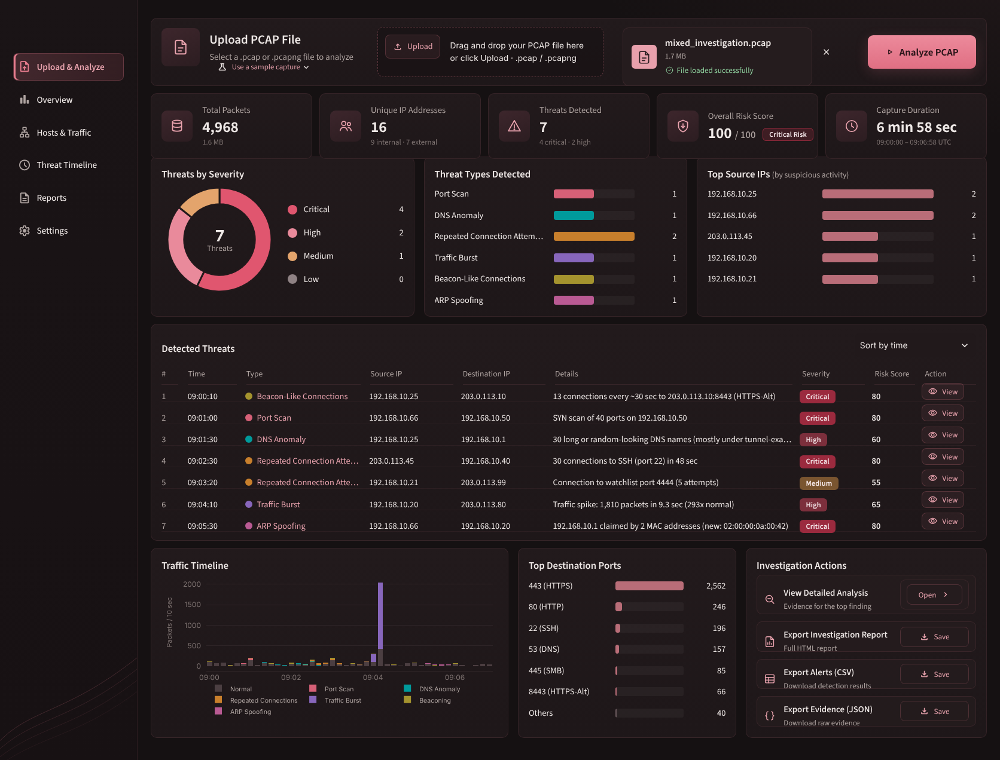
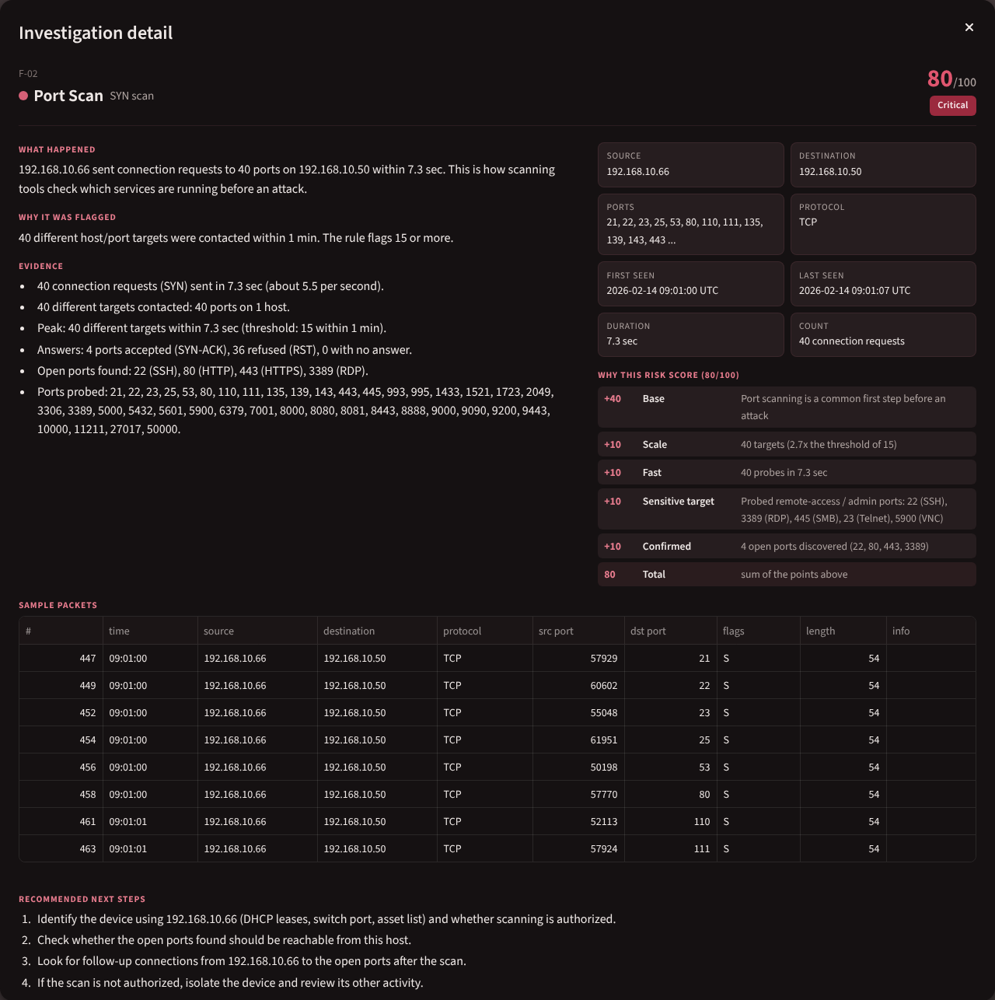
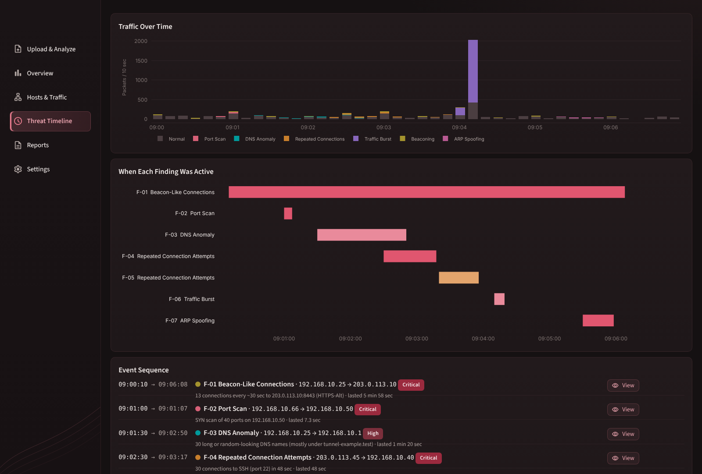
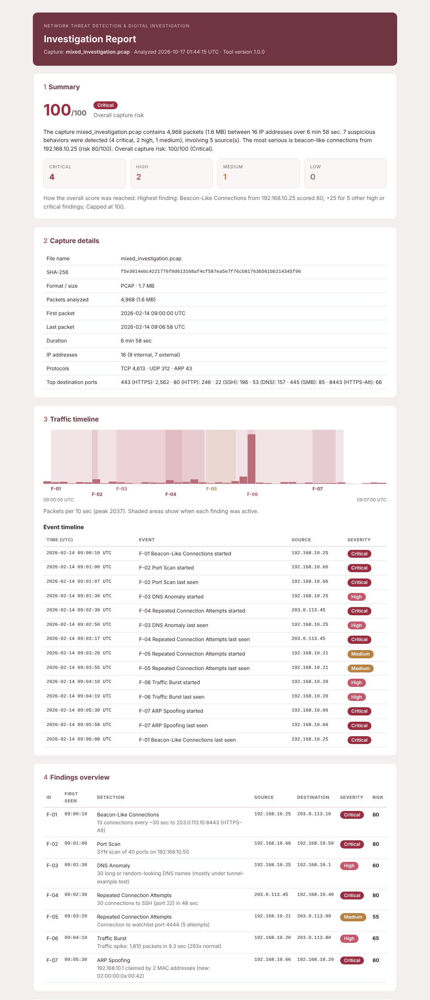

# Network Threat Detection & Digital Investigation

**PCAP Analysis & SOC Investigation Dashboard**

[](https://github.com/danahfawaz/network-threat-detection-investigation/actions/workflows/tests.yml)


### ▶ [Live demo: threat-investigation.streamlit.app](https://threat-investigation.streamlit.app/)

Open the demo, choose **Use a sample capture → mixed_investigation.pcap** and click **Analyze PCAP**.

A Python application that analyzes network captures (PCAP / PCAPNG), detects suspicious
behavior with clear rules, and shows the **evidence** behind every finding in an interactive
investigation dashboard.

You upload a capture. The application parses every packet with Scapy, looks for six kinds of
suspicious activity, explains *what happened* and *why it was flagged*, gives each finding an
explainable risk score, and lets you export an investigation report.



---

## Key Features

- **Upload PCAP / PCAPNG captures**: drag and drop into the dashboard (or use the command line).
- **Analyze network traffic**: packets, hosts, protocols, ports, conversations and a timeline.
- **Detect suspicious behavior**: port scans, DNS anomalies, repeated connection attempts,
  traffic bursts, beacon-like connections and ARP spoofing.
- **Review severity**: every finding is Low, Medium, High or Critical.
- **Review explainable risk scores**: each score (0–100) is broken down point by point.
- **Inspect involved IP addresses**: sources, targets, internal vs. external hosts.
- **View the evidence for each detection**: counts, timings, ports, answers and sample packets.
- **View the traffic timeline**: when each finding was active, over the capture's own timestamps.
- **Analyze ports and protocols**: top destination ports, protocol breakdown, top conversations.
- **Investigate suspicious events**: a focused detail view with recommended next steps.
- **Export an investigation report**: a self-contained HTML report built from the analysis.
- **Export alerts**: CSV for spreadsheets, JSON with full evidence.

## Dashboard Preview

| Investigation detail | Threat timeline |
|---|---|
|  |  |

<details>
<summary>HTML investigation report (first page)</summary>



</details>

## How It Works

```
PCAP / PCAPNG
  → Packet parsing          (Scapy; file type, size and integrity checks first)
  → Traffic analysis        (one normalized row per packet; hosts, ports, protocols, timeline)
  → Threat detection        (six rule-based detections with configurable thresholds)
  → Evidence extraction     (counts, timings, answers, sample packet numbers)
  → Severity & risk scoring (point-based, every point explained)
  → Investigation dashboard (Streamlit)
  → Investigation report    (HTML, CSV, JSON)
```

Everything is deterministic Python: the same capture always gives the same findings.

## Project Evolution

This project grew out of an academic **network management** foundation: understanding how
hosts, addresses, ports and protocols behave on a network. I independently extended that
foundation into a cybersecurity tool that looks at the same traffic from an investigator's
point of view, adding:

- automated PCAP analysis with Scapy
- rule-based threat detection
- digital investigation workflow (what happened → why → evidence → next steps)
- evidence extraction down to individual packets, plus a SHA-256 hash of the analyzed file
- severity classification
- explainable risk scoring
- an interactive Streamlit dashboard
- investigation reporting (HTML, CSV, JSON)

## Detection Capabilities

| Detection | What it looks for | Default trigger |
|---|---|---|
| **Port Scan / SYN Scan** | One source sending connection requests to many ports or hosts | 15+ different host/port targets within 60 s |
| **DNS Anomalies** | Query floods, long or random-looking names (tunnelling-style), many failed lookups | 100+ queries in 60 s · 5+ suspicious names · 20+ NXDOMAIN with ≥ 50 % failing |
| **Repeated Connection Attempts** | Password-guessing patterns, mostly-failing retries, backdoor ports | 10+ attempts in 120 s to a login port, or with ≥ 70 % failing · 3+ attempts to a watchlist port (e.g. 4444) |
| **Traffic Burst** | A sudden spike from one host compared with its own normal rate | 1,000+ packets in 10 s and ≥ 10× the host's normal rate |
| **Beacon-Like Connections** | Connections at a steady rhythm, like malware checking in | 8+ connections, typical gap 10 s – 1 h, ≥ 80 % of gaps within ±15 % |
| **ARP Spoofing** | One IP address claimed by more than one MAC address | 2+ MAC addresses for one IP |

All thresholds live in [`pcap_investigation/config.py`](pcap_investigation/config.py) and can be
changed for a session on the dashboard's **Settings** view. Full rule descriptions:
[docs/detection-rules.md](docs/detection-rules.md).

## Investigation & Evidence

A finding never just says "threat detected". Each one is presented in the same structure:

- **What happened**: a plain-language description.
- **Why it was flagged**: the exact threshold that was crossed.
- **Evidence**: the measured facts (e.g. *"40 connection requests sent in 7.3 sec · 4 ports
  accepted, 36 refused · open ports: 22 (SSH), 80, 443, 3389 (RDP)"*).
- **Key facts**: source, destination, ports, protocol, first/last seen, duration, event count.
- **Sample packets**: packet numbers you can look up in Wireshark.
- **Recommended next steps** for the investigator.

The investigation also connects related evidence. For example, in the demo capture, the MAC
address that spoofed the gateway is linked to the same IP address that ran the port scan.

## Risk Scoring

The score is a simple sum of points, capped at 100, that you can recompute by hand:

| Factor | Points |
|---|---|
| Base (by behavior type) | Burst 30 · DNS 35 · Port scan 40 · Repeated attempts 40 · Beaconing 45 · ARP spoofing 55 |
| Scale: how far past the threshold | 1–2× +5 · 2–4× +10 · 4–8× +15 · 8×+ +20 |
| Fast | +10 |
| Sensitive target (login/admin port, gateway, external destination …) | +10 |
| Persistent (5 minutes or more) | +10 |
| Confirming evidence (open ports found, unsolicited ARP replies, one-way upload …) | +10 |

**Severity comes directly from the score:** 0–39 Low · 40–59 Medium · 60–79 High · 80–100 Critical.

Example from the demo capture:

```
Port Scan from 192.168.10.66 - 80/100 (Critical)
  +40 Base        Port scanning is a common first step before an attack
  +10 Scale       40 targets (2.7x the threshold of 15)
  +10 Fast        40 probes in 7.3 sec
  +10 Sensitive   Probed remote-access / admin ports: 22 (SSH), 3389 (RDP), 445 (SMB) ...
  +10 Confirmed   4 open ports discovered (22, 80, 443, 3389)
```

The **overall capture risk** is the highest finding score plus 5 for each other High or
Critical finding (maximum 100). Details: [docs/risk-scoring.md](docs/risk-scoring.md).

## Reporting

| Export | Contents |
|---|---|
| **Investigation report (HTML)** | Summary and overall risk, capture details with SHA-256, traffic timeline, event sequence, every finding with evidence, score breakdown and sample packets, involved hosts, recommended steps, rules and thresholds used |
| **Alerts (CSV)** | One row per finding, protected against spreadsheet formula injection |
| **Evidence (JSON)** | Machine-readable findings, sample packets, metrics and the configuration used |

All exports are generated from the analysis of the selected capture; nothing is static.

## Architecture / Project Structure

```
├── app/                         Streamlit dashboard
│   ├── streamlit_app.py         entry point and sidebar navigation
│   ├── views/                   Upload & Analyze, Overview, Hosts & Traffic,
│   │                            Threat Timeline, Reports, Settings, detail dialog
│   ├── charts.py · components.py · theme.py · style.css
├── pcap_investigation/          analysis engine (no Streamlit dependency)
│   ├── loader.py                file validation, SHA-256, Scapy reading
│   ├── normalize.py             packets → one pandas row per packet
│   ├── traffic.py               hosts, ports, protocols, conversations, timeline
│   ├── detections/              one module per rule
│   ├── scoring.py               explainable risk scoring
│   ├── pipeline.py              analyze_capture(): the whole flow in one call
│   ├── reporting/               HTML report, CSV/JSON exports, evidence helpers
│   ├── config.py                all detection thresholds
│   └── cli.py                   command-line interface
├── samples/                     synthetic captures + expected results
├── scripts/generate_samples.py  builds the synthetic captures with Scapy
├── tests/                       pytest suite (engine, reports, dashboard)
└── docs/                        architecture, rules, scoring, validation, screenshots
```

More detail: [docs/architecture.md](docs/architecture.md).

## Validation

### Synthetic validation

Eight synthetic captures were built packet by packet with Scapy, each designed to trigger
specific rules (and one with only normal traffic). The test suite checks that every file
produces **exactly** its expected findings, no more and no fewer.

| Sample | Expected | Result |
|---|---|---|
| `benign_traffic.pcap` | No findings | ✅ 0 findings |
| `port_scan.pcap` | Port Scan | ✅ |
| `dns_anomaly.pcap` | 3 DNS anomalies (names, failed lookups, flood) | ✅ |
| `repeated_connections.pcap` | SSH password guessing + watchlist port 4444 | ✅ |
| `traffic_burst.pcap` | Traffic Burst | ✅ |
| `beaconing.pcap` | Beacon-Like Connections | ✅ |
| `arp_spoofing.pcap` | ARP Spoofing | ✅ |
| `mixed_investigation.pcap` | All 7 findings above | ✅ |

The full suite has **136 automated tests** covering parsing, normalization, every detection
rule and its threshold boundaries, evidence, scoring, reports, CSV/JSON exports, error handling
(empty, corrupted, truncated and wrong-type files) and the dashboard itself (via Streamlit's
`AppTest`). See [docs/validation.md](docs/validation.md).

### Real public PCAP validation

Validation against a real public capture is tracked separately in
[docs/validation.md](docs/validation.md#real-public-pcap-validation).

## How to Run

Requires **Python 3.10+**.

```bash
git clone https://github.com/danahfawaz/network-threat-detection-investigation.git
cd network-threat-detection-investigation

python -m venv .venv
# Windows:      .venv\Scripts\activate
# macOS/Linux:  source .venv/bin/activate

pip install -r requirements.txt
streamlit run app/streamlit_app.py
```

Open the address Streamlit prints (usually http://localhost:8501), then upload a capture or
choose **Use a sample capture → mixed_investigation.pcap** and click **Analyze PCAP**.

Run the tests:

```bash
python -m pytest
```

Command line (no dashboard):

```bash
python -m pcap_investigation samples/mixed_investigation.pcap --html report.html --csv alerts.csv
```

> Reading capture files does not need Npcap or root rights. Scapy may print a warning about a
> missing capture library on Windows; it can be ignored, since live capture is not used.

## Technology Stack

| Purpose | Technology |
|---|---|
| Packet parsing | Python, Scapy |
| Data processing | pandas |
| Dashboard | Streamlit, Plotly |
| Reports | Jinja2 (HTML), Python `csv` / `json` |
| Testing | pytest, Streamlit AppTest |

## Scope & Limitations

- **Offline analysis** of saved captures; it does not capture live traffic.
- **Rule-based detection** with explainable thresholds, not machine learning. Thresholds may need
  tuning for very busy or unusual networks.
- Built as an **investigation and learning tool** for analysts and portfolio use, not as a
  production intrusion detection system.
- Encrypted payloads are not inspected; detections rely on traffic patterns and headers.
- Captures are read into memory; the default limits are 200 MB and 500,000 packets.

## Future Enhancements

- Live capture support
- Additional detection rules (for example, cleartext credential protocols or ICMP tunnelling)
- Saving and loading custom threshold profiles
- AI-assisted investigation summaries, as an optional layer on top of the rule-based evidence
- Threat intelligence lookups for external IP addresses and domains
- Richer reporting (PDF export, side-by-side comparison of two captures)

## License

MIT, see [LICENSE](LICENSE). © 2026 Danah Fawaz
