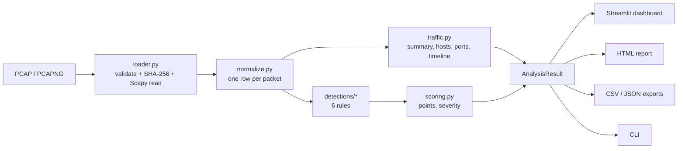

# Architecture

The project has two parts that are deliberately kept separate:

- **`pcap_investigation/`**: the analysis engine. Plain Python, no Streamlit. It can be used
  from the dashboard, the command line or the tests.
- **`app/`**: the Streamlit dashboard. It only *displays* an `AnalysisResult`; it never does
  analysis itself.

## Data flow

1. **Load** (`loader.py`): checks the file extension, size limit and the first four bytes
   (pcap / pcapng magic numbers) *before* parsing, computes the SHA-256 hash, then reads packets
   with Scapy. Truncated files are read as far as possible and a warning is recorded. Errors are
   raised as `CaptureError` subclasses whose message is safe to show to a user.
2. **Normalize** (`normalize.py`): each Scapy packet becomes one row of a pandas DataFrame:
   time, MACs, IPs, protocol, ports, TCP flags, DNS fields (query name, type, response code)
   and ARP fields. This is the only module that knows about Scapy layers. A packet that cannot
   be parsed is kept as an "Unparsed" row instead of stopping the analysis.
3. **Summarize** (`traffic.py`): capture-wide statistics: packets, bytes, duration, hosts
   (internal vs. external), protocols, top destination ports, per-host and per-conversation
   tables, and a packet timeline.
4. **Detect** (`detections/`): each rule is a function `detect(packets, config) -> list[Finding]`.
   A `Finding` contains the plain-language explanation, evidence lines, key facts, sample
   packet numbers, metrics, and the *scoring signals* (ratio past the threshold, and whether it
   was fast / sensitive / persistent / confirmed, each with a reason).
5. **Score** (`scoring.py`): turns the signals into points, a 0–100 score and a severity.
   The overall capture score is derived from the findings.
6. **Present**: dashboard (`app/`), HTML report (`reporting/html_report.py`), CSV/JSON
   (`reporting/exports.py`) and CLI (`cli.py`) all read the same `AnalysisResult`.

## Design decisions

| Decision | Why |
|---|---|
| One normalized DataFrame | Every rule works on the same simple table, which is easy to test and to explain |
| Rules return evidence, not just a flag | The investigator needs to see *why*, and the report reuses the same text |
| Scoring separated from detection | Rules describe facts; one small module decides points, consistently for all rules |
| Severity derived from the score | Severity and score can never disagree |
| Thresholds in one config dataclass | Easy to tune, shown in the report, editable per session in the dashboard |
| No AI / external services | Results are deterministic, offline and fully explainable |

## Security considerations in the code

- **Untrusted input**: packet contents (DNS names, for example) are attacker-controlled. The
  dashboard escapes every capture-derived value before placing it in HTML, and the report uses
  Jinja2 autoescaping. A test feeds `<script>` tags through DNS names to prove it.
- **CSV injection**: cells starting with `=`, `+`, `-`, `@` are prefixed so spreadsheet programs
  do not run them as formulas.
- **Uploaded files** are written to a temporary file only for parsing and deleted right after.
- **Resource limits**: a file-size limit (200 MB) and packet limit (500,000) protect memory.
- **Privacy**: Streamlit usage statistics are disabled in `.streamlit/config.toml`.

## Dashboard structure

| View | Purpose |
|---|---|
| Upload & Analyze | Main dashboard (upload, summary cards, threat overview, threats table, timeline, ports, actions) |
| Overview | Analysis summary and capture file facts (hash, time range, protocols) |
| Hosts & Traffic | Every IP address with traffic counts and linked findings; top conversations |
| Threat Timeline | Traffic over time, when each finding was active, event sequence |
| Reports | Download HTML / CSV / JSON and preview the report |
| Settings | Enable or disable rules and change thresholds for the current session |
